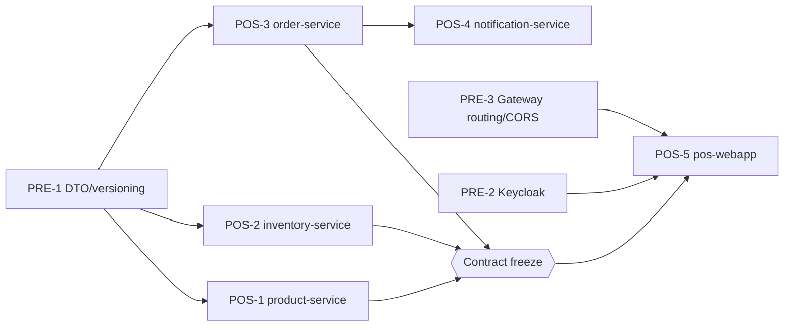

# Gap POS insourcing — parallel refactor tickets

Tracking doc for moving the vendor-built Gap store POS onto services we own. The
React + Vite frontend (`pos-webapp/`) already exists and runs on bundled fixtures
(`VITE_USE_MOCK=true`). These tickets give the backend services the contracts that
`pos-webapp/src/api/types.ts` already assumes, then switch the frontend to the live
path through `api-gateway` on port 8181.

**Base branch:** `devin/1790096169-gap-pos-webapp`. Each ticket gets its own branch
cut from that base and its own PR back into it.

**Scope:** this doc only breaks down and scopes the work. It contains no
implementation.

## Tracker

| ID | Ticket | Service | Depends on | Can start | Status | Session | PR |
| --- | --- | --- | --- | --- | --- | --- | --- |
| PRE-1 | Shared DTO and versioning conventions | all | — | now (doc sign-off) | Signed off (conventions only, no code) | — | — |
| PRE-2 | Keycloak auth flow for the POS app | `realms/`, `api-gateway`, `pos-webapp` | — | now | In review (QA passed, video recorded) | [PRE-2](https://devin-gtm.devinenterprise.com/sessions/aeceb86ba6564defac2b72bb6765485a) | [#60](https://github.com/COG-GTM/ecommerce-microservices/pull/60) |
| PRE-3 | Gateway routing and CORS | `api-gateway` | — | now | In review (QA passed, video recorded) | [PRE-3](https://devin-gtm.devinenterprise.com/sessions/651450b8cc3f4555886e4b42a812b3c9) | [#59](https://github.com/COG-GTM/ecommerce-microservices/pull/59) |
| POS-1 | SKU/hangtag lookup + variant model | `product-service` | PRE-1 | now | In review (QA passed, video recorded) | [POS-1](https://devin-gtm.devinenterprise.com/sessions/8e3cd44367ce4dbc97bb674b41f2b66b) | [#58](https://github.com/COG-GTM/ecommerce-microservices/pull/58) |
| POS-2 | Store inventory, nearby stores, ship-from-store | `inventory-service` | PRE-1 | now | In review (QA passed, video recorded) | [POS-2](https://devin-gtm.devinenterprise.com/sessions/bc3ad732710e46ff9e384958dadf8a46) | [#56](https://github.com/COG-GTM/ecommerce-microservices/pull/56) |
| POS-3 | POS order model + enriched order event | `order-service` | PRE-1 | now | In review (QA passed, video recorded) | [POS-3](https://devin-gtm.devinenterprise.com/sessions/74e2a669675d4c9b96d776d171efa81a) | [#57](https://github.com/COG-GTM/ecommerce-microservices/pull/57) |
| POS-4 | Receipt and fulfillment notifications | `notification-service` | POS-3 (event contract merged) | after POS-3 | In review (QA passed, video recorded) | [POS-4](https://devin-gtm.devinenterprise.com/sessions/67ae9a0d9ae94f7288baa2eba268db5b) | [#61](https://github.com/COG-GTM/ecommerce-microservices/pull/61) |
| POS-5 | Frontend contract alignment + live gateway path | `pos-webapp` | POS-1..3 contract freeze, PRE-2, PRE-3 | after freeze | In review (live E2E through :8181 passed, video recorded) | [POS-5](https://devin-gtm.devinenterprise.com/sessions/3bfb563ac8a54d0ca3a840d49d7d91e2) | [#62](https://github.com/COG-GTM/ecommerce-microservices/pull/62) |

**Parallelism.** POS-1, POS-2 and POS-3 have no code dependency on each other and
run at the same time. POS-3 calls product-service and inventory-service, but only
through the contracts frozen in this doc. Its tests stub those services, so it does
not wait for POS-1 or POS-2 to merge. POS-4 starts once POS-3's `OrderPlacedEvent`
v2 schema is merged. POS-5 starts at **contract freeze**, the point when POS-1..3
each have the request/response DTOs and the controller signatures from this doc
merged, even if business logic is still in review. PRE-2 and PRE-3 are small and
can be done alongside POS-1..3, but they must merge before POS-5's live validation.

## Baseline: what's on the branch today

Read from `devin/1790096169-gap-pos-webapp` (Spring Boot 3.1.3, Spring Cloud
2022.0.4, Java 17).

| Area | Current state | Gap vs. `pos-webapp/src/api/types.ts` |
| --- | --- | --- |
| `product-service` | `Product{id,name,description,price}` in Mongo. `GET /api/product` returns everything and **ignores `?skuCode=`**. | No SKU, style, color, size, variants, list vs. sale price, clearance or final-sale fields. `client.ts#getProductBySku` falls back to `products[0]`, so in live mode it silently shows the wrong item. |
| `inventory-service` | `Inventory{id,skuCode,quantity}`, no store dimension. `GET /api/inventory?skuCode=a&skuCode=b` returns `[{skuCode,inStock}]`. Seeded with `iphone_15` / `iphone_15_pro`. | No `storeId`, `onHand`, nearby stores, ship-from-store, floor or fixture. The client expects one object back, not an array. |
| `order-service` | `OrderRequest{orderLineItemsDtoList[{skuCode,price,quantity}]}`. Returns the plain string `"Order Placed Successfully!"`. The circuit-breaker fallback also returns **201** with a string. It trusts the client-supplied `price`. | No store, register or associate data, promotions, services/fees, tenders or tax-exempt flag. `client.ts#placeOrder` calls `response.json()`, which fails on the plain-string body. |
| order → inventory | Sends every SKU to `inventory-service`, then `allMatch(isInStock)`. | An unknown SKU comes back as no row, and `allMatch` on an empty array is `true`, so the order goes through. |
| `OrderPlacedEvent` | `{orderNumber}` only, topic `notificationTopic`, no key, sent inside the `@Transactional` method before commit. | Has no data to build a receipt or a fulfillment request from. |
| `notification-service` | One `@KafkaListener` that logs the order number. No `src/test`. | No receipt or fulfillment notifications. |
| `api-gateway` | Routes `Path=/api/product` and `Path=/api/order`. Has `CorsConfig` for `localhost:5173`. Is a JWT resource server. | **No `/api/inventory` route**, so `getInventory()` in live mode returns 404 at the gateway. Local `issuer-uri` points to `localhost:8181`, but Keycloak listens on `8080`. |
| `realms/spring-boot-microservices-realm.json` | One confidential client `spring-cloud-client` with only client-credentials enabled. | No public browser client and no POS roles. Today the SPA relies on a pasted `VITE_API_TOKEN`. |
| `pos-webapp` | Mock mode by default. `lib/totals.ts#calculateTotals` computes totals in the browser. The promo catalog (`FALL30`, `CARD10`) is hard-coded in `StoreCheckout.tsx`. Services & fees is a constant `12.00` in `fixtures.ts`. | Pricing has to move to the server so the client can't make up totals. |

---

## Cross-cutting prerequisites

### PRE-1 — Shared DTO and versioning conventions

Every ticket follows these rules. The deliverable is agreement on this section, not
code. POS-1..3 implement the rules inside their own service, so no shared library
module is introduced.

**Contract source of truth.** The frontend already encodes the target shapes, so
`pos-webapp/src/api/types.ts` and `pos-webapp/src/api/fixtures.ts` are the contract.
Backend DTOs mirror their field names exactly (camelCase JSON). If a ticket needs to
change a field, it updates this doc and `types.ts` in the same PR.

**Golden data.** The three fixture SKUs are the shared test data for every service,
and each service seeds them in its dev profile:
- `268341-016-L`: Vintage Soft Crewneck Tee, 40% clearance, final sale
- `471902-004-29`: High Rise Straight Jean, full price
- `512884-022-M`: Logo Fleece Hoodie, 30% clearance, not eligible for ship-from-store

The values (prices, store on-hand, nearby stores, floor/fixture) are copied exactly
from `fixtures.ts`. Store `1969`, register `04`, associate `A-4471`.

**Versioning.**
- REST changes are additive only on the existing paths (`/api/product`,
  `/api/inventory`, `/api/order`). Keep existing fields. Any rename or removal goes
  to a new `/api/v2/...` path.
- Responses must not break the legacy callers. In particular, `order-service` keeps
  calling inventory with the legacy array form until POS-3 moves it to the
  store-aware form.
- Kafka events carry a `schemaVersion` integer (v1 = today's `{orderNumber}`, v2 =
  enriched). Producer and consumer keep the existing type-mapping token `event:` so
  a v2 producer and a v1 consumer can still talk (Spring Kafka's `JsonDeserializer`
  ignores unknown properties by default; POS-4 checks this in a test).

**Money.** `BigDecimal`, scale 2, serialized as a JSON number (`types.ts` uses
`number`). Server-side rounding must give the same results as
`lib/totals.ts#roundCurrency` on the golden cart. Plain `BigDecimal` HALF_UP can
differ from the JS double math on half-cent ties, so parity is an explicit test.

**Errors.** Use `application/problem+json` (Spring 6 `ProblemDetail`) with a stable
`type` slug:
- `404 sku-not-found`
- `409 out-of-stock`
- `422 invalid-promotion` / `validation-failed`
- `503 dependency-unavailable` for circuit-breaker fallbacks

No more 2xx plain-string bodies.

**Golden-cart parity numbers.** Every pricing test uses this cart: the 3 fixture
SKUs × 1, promo `FALL30`, services & fees `12.00`, tax 8.625%.

| Field | Value |
| --- | --- |
| merchandiseTotal | 159.85 |
| discountTotal | 63.54 |
| taxableSubtotal | 108.31 |
| salesTax | 9.34 |
| total | 117.65 |
| total (tax exempt) | 108.31 |

The discount total is markdowns `29.96` plus promo `33.576`. Promotions skip
final-sale lines.

**Acceptance criteria**
- [ ] This section is reviewed and signed off before POS-1..3 merge their DTOs.
- [ ] Each of POS-1..3 references PRE-1 in its PR description and includes a
      golden-data test.

### PRE-2 — Keycloak auth flow for the POS app

**Affected paths**
- `realms/spring-boot-microservices-realm.json`
- `api-gateway/src/main/resources/application.properties`
- `api-gateway/src/main/java/com/ibatulanand/apigateway/config/SecurityConfig.java`
- `docker-compose.yml` (keycloak and api-gateway env)
- `pos-webapp/src/api/config.ts`, `pos-webapp/src/main.tsx`, `pos-webapp/.env.example`, `pos-webapp/README.md`

**Scope**
- Add a **public** client `pos-webapp`:
  - Authorization Code + PKCE (S256)
  - `redirectUris` `http://localhost:5173/*`, `webOrigins` `http://localhost:5173`
  - direct-access grants disabled
- Add realm roles `pos-associate` and `pos-manager`, and a demo user with an
  `associate_id` attribute mapped into the access token as an `associate_id` claim.
- Make the token issuer the same for browser-issued and gateway-validated tokens.
  Today the local `issuer-uri` is `http://localhost:8181/realms/...`, Keycloak
  issues tokens from `:8080`, and in compose the gateway validates against
  `keycloak:8080`. Fix with a fixed Keycloak hostname (`KC_HOSTNAME`) or a separate
  `jwk-set-uri` plus an explicit issuer.
- Gateway: keep `/api/**` authenticated. Require `pos-associate` on POS routes by
  mapping realm roles to authorities.
- pos-webapp: when `VITE_USE_MOCK=false`, log in through the PKCE redirect (e.g.
  `keycloak-js` or `oidc-client-ts`), keep the token in memory and refresh it.
  `VITE_API_TOKEN` stays as a local-only override.

**Out of scope (follow-up).** Downstream services enforcing the associate identity
from the JWT instead of the request body.

**Acceptance criteria**
- [ ] A fresh `docker compose up` imports the realm with the `pos-webapp` client
      and the demo user.
- [ ] The browser at `:5173` redirects to Keycloak, logs in, and calls
      `GET http://localhost:8181/api/product` with `Authorization: Bearer ...` → 200.
- [ ] A token without `pos-associate` gets 403. No token gets 401. Preflight
      `OPTIONS` stays 200 with no token.
- [ ] No client secret appears in the frontend bundle or in git.

### PRE-3 — Gateway routing and CORS

**Affected paths**
- `api-gateway/src/main/resources/application.properties`
- `api-gateway/src/main/java/com/ibatulanand/apigateway/config/CorsConfig.java`
- `docker-compose.yml` (`APP_CORS_ALLOWED_ORIGINS`)

**Scope**
- Add `spring.cloud.gateway.routes[n]` for `inventory-service`
  (`lb://inventory-service`, `Path=/api/inventory`).
- Widen product and order predicates to `/api/product/**` and `/api/order/**` if
  POS-1 or POS-3 add sub-paths.
- Keep `CorsConfig` driven by `app.cors.allowed-origins`. Add the store/demo origins
  through `APP_CORS_ALLOWED_ORIGINS`, and expose `Location` and `Content-Type` on
  responses. Keep the `DedupeResponseHeader` default filter so downstream CORS
  headers don't get duplicated.

**Acceptance criteria**
- [ ] `curl -H "Authorization: Bearer $T" 'http://localhost:8181/api/inventory?skuCode=268341-016-L&storeId=1969'`
      reaches inventory-service (no gateway 404).
- [ ] Preflight from `http://localhost:5173` for `POST /api/order` with an
      `Authorization` header returns 200 with exactly one
      `Access-Control-Allow-Origin`.
- [ ] A request from an origin that isn't allowed is rejected by CORS.
- [ ] The Eureka routes keep working.

---

## POS-1 — product-service: SKU/hangtag lookup, variants, clearance and final-sale

**Depends on:** PRE-1. Runs in parallel with POS-2 and POS-3.

**Affected paths** (all under `product-service/src/main/java/com/ibatulanand/productservice/` unless noted)
- `model/Product.java` (and a new `model/ProductVariant.java`)
- `dto/ProductRequest.java`, `dto/ProductResponse.java` (and a new `dto/ProductVariantResponse.java`)
- `repository/ProductRepository.java`
- `service/ProductService.java`
- `controller/ProductController.java`
- a new dev-profile seed (e.g. `config/ProductSeedData.java`, or a `CommandLineRunner` in `ProductServiceApplication.java`)
- `product-service/src/test/java/com/ibatulanand/productservice/ProductServiceApplicationTests.java` (and new controller/service tests)

**Scope**
- **Model.** One Mongo document per style, holding a list of variants, one variant
  per sellable SKU.
  - Style fields: `styleId`, `name`, `description`, `department`, `category`.
  - Variant fields: `skuCode` (`<style>-<color>-<size>`, the hangtag value),
    `colorName`, `colorCode`, `size`, `listPrice`, `salePrice`,
    `clearancePercent`, `finalSale`.
  - Keep the legacy `price` field, mapped to `listPrice`, so existing callers
    still work.
  - Add a unique index on `variants.skuCode`.
- **Lookup.** `GET /api/product?skuCode={sku}` returns **one** `ProductResponse`,
  flattened to the scanned variant, with `variants[]` listing the style's other
  color/size options. Unknown SKU → `404 sku-not-found`. Accept the hangtag
  formatted with or without dashes; normalize to the canonical form.
  `GET /api/product` with no parameter still returns the list.
- `ProductResponse` matches `types.ts#Product` field for field.
- `POST /api/product` accepts the extended request. Reject a variant if:
  - `salePrice > listPrice`
  - `clearancePercent` is outside 0–100
  - `clearancePercent > 0` and `salePrice` doesn't match `listPrice × (1 − pct)`
    within ±0.01
- Seed the three golden SKUs in the dev profile.

**Acceptance criteria**
- [ ] `GET /api/product?skuCode=268341-016-L` → 200, body equals
      `MOCK_PRODUCTS[0]` from `fixtures.ts`. JSON-equality test against a copy of
      the fixture.
- [ ] `GET /api/product?skuCode=999999-000-X` → 404 `problem+json` with
      `type` ending in `sku-not-found`.
- [ ] `GET /api/product` still returns a list, and legacy `name/description/price`
      are present.
- [ ] Mongo Testcontainers test (`mvn -pl product-service test`) covers create,
      lookup by SKU, unique-SKU violation, and the validation rules. It self-skips
      without Docker, as today.
- [ ] No other module's code changes in this PR.

---

## POS-2 — inventory-service: per-store on-hand, nearby stores, ship-from-store

**Depends on:** PRE-1. Runs in parallel with POS-1 and POS-3. The gateway route is
handled in PRE-3.

**Affected paths** (all under `inventory-service/src/main/java/com/ibatulanand/inventoryservice/` unless noted)
- `model/Inventory.java` (gains `storeId`, `onHand`, `floor`, `fixture`, plus a unique key `(skuCode, storeId)`)
- a new `model/Store.java` (`storeId`, `storeName`, `latitude`, `longitude`, `shipFromStoreEnabled`)
- `repository/InventoryRepository.java` (and a new `repository/StoreRepository.java`)
- `service/InventoryService.java`
- `controller/InventoryController.java`
- `dto/InventoryResponse.java` (legacy) and a new `dto/StoreInventoryResponse.java` / `dto/NearbyStoreAvailability.java`
- `InventoryServiceApplication.java` (replace the `iphone_15` seed with golden data in the dev profile)
- `inventory-service/src/test/java/com/ibatulanand/inventoryservice/InventoryServiceApplicationTests.java` (and new tests)

**Scope**
- `GET /api/inventory?skuCode={sku}&storeId={id}` returns **one**
  `StoreInventoryResponse` matching `types.ts#Inventory`: `skuCode`, `storeId`,
  `onHand`, `nearbyStores[]`, `shipFromStoreEligible`, `floor`, `fixture`.
- **Nearby stores.** Up to N (configurable, default 4) other stores with
  `onHand > 0`, nearest first by great-circle distance, `distanceMiles` rounded to
  0.1.
- **Ship-from-store eligibility.** Eligible when the SKU is ship-eligible, at least
  one store with `shipFromStoreEnabled` has `onHand` ≥ a configurable safety stock,
  and the requesting store is not the only source. Seed data reproduces the fixture
  values: `512884-022-M` → `false`, the others → `true`.
- **Legacy form stays.** `GET /api/inventory?skuCode=a&skuCode=b` (no `storeId`)
  still returns `[{skuCode, inStock}]` summed across stores, because
  `order-service` calls it. Add an explicit `inStock=false` row for unknown SKUs
  instead of leaving them out (fixes the `allMatch` empty-array hole; the
  coordinated change is in POS-3).
- Unknown SKU or store on the single-store form → `404`.
- Add `@Transactional(readOnly = true)` to the read path. Remove the commented-out
  sleep block.

**Acceptance criteria**
- [ ] `GET /api/inventory?skuCode=268341-016-L&storeId=1969` returns JSON equal to
      `MOCK_INVENTORY['268341-016-L']`.
- [ ] Same check for the other two SKUs, including `shipFromStoreEligible:false`
      for `512884-022-M`.
- [ ] Legacy array form returns the same shape as today for known SKUs, plus
      `inStock:false` for unknown SKUs.
- [ ] A MySQL Testcontainers test covers nearby-store ordering, the N limit,
      excluding zero on-hand, the eligibility rules, and `(skuCode, storeId)`
      uniqueness.
- [ ] `mvn -pl inventory-service test` is green on JDK 17.

---

## POS-3 — order-service: POS order model, line-level pricing, enriched order event

**Depends on:** PRE-1. Runs in parallel with POS-1 and POS-2. It calls their
**frozen contracts** and stubs them in tests (MockWebServer/WireMock), so it does
not wait for their merges.

**Affected paths** (all under `order-service/src/main/java/com/ibatulanand/orderservice/` unless noted)
- `model/Order.java`: add `storeId`, `registerId`, `associateId`, `status`, `taxExempt`, `taxExemptCertificate`, `placedAt`, and order-level totals (`merchandiseTotal`, `discountTotal`, `servicesAndFees`, `taxableSubtotal`, `taxRate`, `salesTax`, `total`)
- `model/OrderLineItems.java`: add `styleId`, `description`, `colorName`, `size`, `listPrice`, `unitPrice`, `markdownAmount`, `clearancePercent`, `finalSale`, `extendedPrice`, `fulfillmentType`, `fulfillmentStoreId`
- new `model/OrderLinePromotion.java`, `model/OrderServiceFee.java`, `model/OrderTender.java`, `model/Promotion.java` (seeded `FALL30`, `CARD10`)
- `dto/OrderRequest.java`, `dto/OrderLineItemsDto.java`, new `dto/OrderResponse.java`
- `dto/InventoryResponse.java` (and a new product lookup DTO for the frozen POS-1 contract)
- `service/OrderService.java` (and a new `service/PricingService.java`)
- `controller/OrderController.java`
- `event/OrderPlacedEvent.java`
- `src/main/resources/application.properties`: Kafka key serializer, keeping the `event:` type mapping
- `order-service/src/test/java/com/ibatulanand/orderservice/OrderServiceApplicationTests.java` (and new tests)

**Scope**
- **Request.** `POST /api/order` accepts `types.ts#OrderRequest`: `storeId`,
  `registerId`, `associateId`, `lineItems[{skuCode, quantity}]`,
  `promotions[code]`, `tenders[{type, label, amount}]`, `taxExempt`. It adds:
  - `services[{code, description, amount}]` for services & fees
  - per-line optional `fulfillmentType` (`TAKE_WITH` default, or
    `SHIP_FROM_STORE`) with `fulfillmentStoreId`
  - optional `receiptDelivery{channel: EMAIL|SMS|PRINT|NONE, destination}`
  - optional `taxExemptCertificate`

  Client-supplied prices are **ignored**.
- **Server-side pricing.**
  - Look up each SKU through `lb://product-service` (`GET /api/product?skuCode=`,
    POS-1 contract) to get `listPrice`, `salePrice`, `clearancePercent` and
    `finalSale`.
  - Line markdown = (list − sale) × qty.
  - Spread promotions over the lines that are not final sale, in proportion to
    their extended price. Per-line allocations sum exactly to the order-level
    promotion total; any rounding remainder goes to the last eligible line.
  - Apply services & fees, then tax at the store rate (8.625% for `1969`). Tax is
    0 when `taxExempt`, and tax-exempt requires `taxExemptCertificate`.
  - Totals must equal the PRE-1 golden-cart numbers.
- **Stock check.**
  - Use the store-aware inventory contract (POS-2) for `TAKE_WITH` lines at
    `storeId`.
  - `SHIP_FROM_STORE` lines require `shipFromStoreEligible`.
  - An unknown SKU or missing inventory row fails the order (`409 out-of-stock`).
    Close the empty-array `allMatch` hole.
- **Tenders.** The sum of tender amounts must equal `total` (`422` otherwise).
  Store only tender type, label and amount, never card data.
- **Response.** `201` with `OrderResponse{orderNumber, status: "COMPLETED", message,
  totals}`, where `totals` matches `types.ts#OrderTotals`. The circuit-breaker
  fallback returns **`503` `problem+json`** instead of a 201 string. Keep the
  Resilience4j `inventory` instance, and add one for `product`.
- **Kafka.** Keep publishing to `notificationTopic` and keep the `event:` type
  mapping. `OrderPlacedEvent` becomes schema v2 with:
  - `schemaVersion: 2`
  - `orderNumber`, `storeId`, `registerId`, `associateId`, `placedAt`
  - `lineItems[{skuCode, description, colorName, size, quantity, unitPrice,
    extendedPrice, finalSale, fulfillmentType, fulfillmentStoreId}]`
  - `promotions[code]`, `services[]`, `tenders[{type, amount}]`, `totals`,
    `taxExempt`, `receiptDelivery`

  Message key = `orderNumber`. Publish **after commit**
  (`TransactionSynchronization` / `@TransactionalEventListener`) so a rolled-back
  order never emits an event.

**Acceptance criteria**
- [ ] Golden cart (3 SKUs, `FALL30`, `services:[{code:"ALT",amount:12.00}]`,
      `CREDIT_DEBIT` 117.65) → 201, `totals` exactly as in PRE-1. Tax-exempt with
      certificate → `total` 108.31.
- [ ] Per-line promo allocations sum to the order promo total. The final-sale line
      `268341-016-L` gets 0 promo.
- [ ] Unknown SKU → 409. Unknown promo → 422. Tender mismatch → 422. Inventory
      down → 503 `problem+json`, not a 201.
- [ ] A client-supplied `price` in the request body has no effect on persisted
      prices.
- [ ] `spring-kafka-test` (`@EmbeddedKafka`) test: one v2 event per committed
      order, key = `orderNumber`, payload contains all fields above. No event when
      the save fails.
- [ ] `mvn -pl order-service test` is green on JDK 17. The product and inventory
      stubs use the exact JSON from `fixtures.ts`.

---

## POS-4 — notification-service: receipt and fulfillment notifications

**Depends on:** POS-3, once the `OrderPlacedEvent` v2 schema is merged. It can
start from this doc's schema once POS-3's DTO PR is up.

**Affected paths** (all under `notification-service/src/main/java/com/ibatulanand/notificationservice/` unless noted)
- `NotificationServiceApplication.java`: move the listener into a new `listener/OrderPlacedListener.java`
- `OrderPlacedEvent.java`: v2 fields from POS-3, including nested line, tender and totals types
- new `receipt/ReceiptRenderer.java`, `fulfillment/FulfillmentNotifier.java`
- new `sender/NotificationSender.java` (port) and `sender/LoggingNotificationSender.java` (default adapter, no external provider)
- `src/main/resources/application.properties`: keep the `event:` type mapping; add error-handler / DLT config
- `notification-service/pom.xml`: `spring-kafka-test` is already present; add test sources
- new `notification-service/src/test/java/com/ibatulanand/notificationservice/...` (the module has no tests today)

**Scope**
- Consume `notificationTopic` (group `notificationId`) and accept both v1 and v2
  events. A v1 event (`schemaVersion` missing) logs as today and doesn't fail.
- **Receipt.** For v2 events with `receiptDelivery.channel` `EMAIL` or `SMS`,
  render a receipt from the event alone (no callbacks to order-service):
  - store and register, associate, date/time, order number
  - lines with color/size, markdowns, final-sale marker
  - promotions, services & fees, tax (or "Tax exempt"), total, tender types
  - hand it to `NotificationSender`

  `PRINT` and `NONE` → no outbound message.
- **Fulfillment.** Group `SHIP_FROM_STORE` lines by `fulfillmentStoreId` and send
  one store fulfillment (pick-pack-ship) notification per fulfilling store. If the
  order has such lines, also send a "your items will ship" notice to the customer.
- **Idempotency.** Dedupe on `orderNumber` + notification type so a redelivered
  event doesn't send twice (in-memory or a small store, configurable).
  Deserialization or poison-pill errors go to `notificationTopic.DLT` after bounded
  retries.
- Mask the destination email/phone in logs.

**Acceptance criteria**
- [ ] `@EmbeddedKafka` test: publish the golden-cart v2 event with
      `receiptDelivery:{channel:"EMAIL"}`. Exactly one receipt is sent, and it
      contains the order number, the 3 SKUs, `FALL30`, sales tax `9.34` and total
      `117.65`.
- [ ] An order with one `SHIP_FROM_STORE` line from store `1042` → one fulfillment
      notification for `1042` and one customer ship notice.
- [ ] A v1 `{orderNumber}` payload is still consumed without error.
- [ ] Publishing the same event twice → one receipt. A malformed payload ends up
      on the DLT.
- [ ] No raw email address or phone number in log output.
- [ ] `mvn -pl notification-service test` is green on JDK 17.

---

## POS-5 — pos-webapp: align with the backend contracts and validate the live gateway path

**Depends on:** contract freeze of POS-1, POS-2 and POS-3, plus PRE-2 and PRE-3
merged before live validation. Type and client changes can start at the freeze.
The end-to-end check needs merged backends.

**Affected paths**
- `pos-webapp/src/api/types.ts`
- `pos-webapp/src/api/client.ts`
- `pos-webapp/src/api/fixtures.ts` (kept as the contract fixtures)
- `pos-webapp/src/api/config.ts`
- new `pos-webapp/src/api/contract.test.ts`
- `pos-webapp/src/screens/StoreCheckout.tsx` (submit services, fulfillment and receipt fields; show server totals and error states)
- `pos-webapp/.env.example`, `pos-webapp/README.md`

**Scope**
- **`types.ts`.** Add the frozen shapes:
  - `OrderResponse.totals: OrderTotals`, `status` as a union
  - `OrderRequest.services`, `lineItems[].fulfillmentType` /
    `fulfillmentStoreId`, `receiptDelivery`, `taxExemptCertificate`
  - `ServiceFee`, `FulfillmentType`, `ReceiptDelivery`
  - `ApiProblem` (`problem+json`)

  Existing `Product` and `Inventory` field names stay as they are (the backends
  mirror them).
- **`client.ts`.**
  - `getProductBySku` expects one object and maps 404 to `null`. Remove the
    `products[0]` fallback.
  - `getInventory` maps 404 to `null`.
  - `placeOrder` parses the 201 `OrderResponse` and turns 409/422/503
    `problem+json` into typed errors that the UI shows.
  - Requests use the PRE-2 Keycloak token, with `VITE_API_TOKEN` as a local
    override.
  - Mock mode (`VITE_USE_MOCK=true`) behaves exactly as today.
- **`fixtures.ts`.** Kept as the contract fixtures and the golden data that
  POS-1..3 copy. Add `MOCK_ORDER_RESPONSE` built from the golden-cart totals.
- **`contract.test.ts`.** Checks that every fixture has the shape `types.ts`
  declares (at runtime as well as compile time), and that
  `calculateTotals(golden cart)` equals the PRE-1 numbers, so frontend and backend
  totals are pinned to the same values.
- **Live mode.** With `VITE_USE_MOCK=false`, use the server's `totals` from the
  order response for the charge confirmation. Show a mismatch between the client
  preview and the server totals as a warning, never silently.

**Acceptance criteria**
- [ ] `npm run typecheck`, `npm run lint` and `npm run test` pass, including
      `contract.test.ts`.
- [ ] `VITE_USE_MOCK=true`: the screen renders the same as before the change
      (visual check against the current branch).
- [ ] `VITE_USE_MOCK=false` against `api-gateway` on `http://localhost:8181` with
      services built from source:
  - [ ] Keycloak login (PRE-2) works.
  - [ ] Scanning each golden SKU renders the same line item, color/size, clearance
        and final-sale badges, store on-hand, nearby stores and ship-from-store
        flag as mock mode.
  - [ ] An unknown SKU shows "not found" (not the wrong item).
  - [ ] Charging the golden cart returns an order number with total `$117.65`.
  - [ ] notification-service logs the receipt (POS-4).
- [ ] Error paths are visible in the UI: out-of-stock (409), bad promo (422),
      inventory down (503).
- [ ] The browser network panel shows no CORS errors and exactly one
      `Access-Control-Allow-Origin` per response.

---

## Working conventions for every ticket

- **One ticket = one branch = one PR.** Branch from
  `devin/1790096169-gap-pos-webapp` (e.g. `devin/<ts>-pos-1-product-sku-lookup`)
  and open the PR back into it. Commit messages include `feature` or `bug`.
- **Stay in your service.** A ticket touches only the paths listed for it.
  Contract changes go into this doc in the same PR, and the PR is flagged for the
  other ticket owners.
- **No CI on this repo.** Verify locally and paste the output into the PR:
  - JDK 17 (JDK 21 breaks Lombok)
  - Backend tests: `mvn -pl <service> test`
  - Frontend checks: `npm run typecheck && npm run lint && npm run test` in
    `pos-webapp/`
  - MySQL/Mongo Testcontainers need Docker. On Docker 29 hosts, bump Testcontainers
    (the parent `pom.xml` pins the 1.19.0 BOM) and/or set `api.version=1.44` in
    `~/.docker-java.properties`.
- **Run the live path from source.** The `docker-compose.yml` service images are
  the upstream `ibatulanandjp/*:latest` and **won't include these changes**. For
  POS-5 validation, run the infrastructure containers from compose and the
  services from source (`mvn -pl <service> spring-boot:run`, or build local
  images with Jib). Local `application.properties` uses MySQL on `localhost:3306`
  as `root/mysql`, while compose publishes `mysql-order` on 3307 and
  `mysql-inventory` on 3308 with different credentials; override the
  `SPRING_DATASOURCE_*` settings accordingly.
- **When a ticket merges,** update its row in the tracker above (status and PR
  link).
